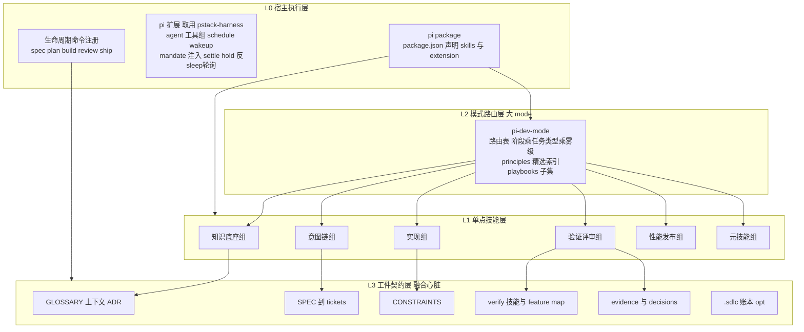

# 融合架构设计(pi-dev-mode v0)

> 目标:一套 pi-agent 原生的技能栈——**大 mode 一键进场,单点技能独立爆破**,
> 三栈精华各就各位,并以工件契约(web of artifacts)作为融合的真正心脏。

## 1. 设计公理(七条,继承与修正)

1. **工件驱动,不拥有流程**(修正自 mattp 的反流程所有权):所有技能可独立使用、可用完即弃;mode 只是路由器,不守门。技能间的契约是"读写同一批工件",不是"按某种顺序调用我"。
2. **门是谓词,不是人**;但**账本是 opt-in**(修正我方 sdlc-unified-design):`.sdlc/` 状态机降级为"可选审计账本",默认关闭;默认强制项只有工件契约(缺 GLOSSARY 可以,谎称验证过不行)。
3. **每个论断同句携带证据或标签**;**验证者不得是作者**(pstack 全盘继承)。
4. **质量是数据,不是散文**(继承 addyosmani):能写成 CONSTRAINTS.md 里带数字的行,就不写成技能里的劝导句。
5. **单点技能保持中立格式**(name + description frontmatter,skills.sh/Agent Skills 规范);宿主差异下沉到一份映射文档(pstack-harness 模式)。
6. **入口有两条**:大 mode 自动路由(mandate 注入)+ 生命周期命令显式入口(/spec、/build 等,Pi 上注册为扩展命令)。显式永远覆盖自动。
7. **技能可替换**:每个融合技能标注来源与处置(canonical / fork / reference / drop),fork 的必须有登记理由(学 pstack-harness 的 forks.json 治理)。
8. **基座优先(基座 是宿主)**:已在 `~/.agents/skills/` 使用的 基座 11 件是第一语料;三栈只做升级包,不推翻、不重写、可回滚。升级方式优先是"加节/加 reference/加路由",而不是改既有正文。

## 2. 四层架构



### L0 宿主执行层(pi 原生,最大程度复用 pstack-harness)
- `package.json`:`pi.skills: [./skills]` + `pi.extensions: [./pi/index.ts]`
- **扩展直接取用 pstack-harness/pi**(它已解决:agent/send_message/schedule_wakeup 工具组、worktree 隔离、print 模式 settle-hold、sleep 反轮询、模型路由 sheet)。两法任选:vendor 进仓(推荐,fork 登记)或作为依赖声明
- 增量注册:生命周期命令(/spec /build 等)注册为扩展命令(pi 扩展可 registerCommand),词表沿用 addyosmani 的 TOML 内容
- mandate 注入内容换成我们的路由指令(见 §4)

### L1 单点技能层(细节在 03-skill-matrix)
**15 件基座技能为底座**(知识底座/意图链/实现/执行链的主体已就位,2026-10 去除 `dev-` 前缀),叠加三栈新增 ~8 件(spec 工厂、build、wayfinder、constraints、review 管线、benchmark/perf、ship、verify×2、retro、use-the-stack)。

### L2 模式路由层:`pi-dev-mode`
- 入口路由表(§4)+ 精选 principles 索引(从 24 条压到融合栈实际用到的 ~12 条,去重后)+ 精选 playbooks(不需要 23 个全带,带意图链/实现/验证/发布核心 ~10 个)
- mandate 每 agent-start 注入(复用 pstack-harness 的 before_agent_start 模式)

### L3 工件契约层(融合的真正心脏)
**这是本次融合相对三栈的最大增量**:三栈各自最强的部分,恰好是彼此的工件。pstack 有验证机器但没需求入口;mattp 有需求管道但没验证闸门;addyosmani 有质量合同但没独立裁决。把它们缝在同一批工件上,技能就自然咬合:

| 工件 | canonical 来源 | 谁写 | 谁读 |
|---|---|---|---|
| `docs/GLOSSARY.md`(+`docs/GLOSSARY-MAP.md` 多上下文;legacy 根文件/`CONTEXT.md` 照读)、`docs/adr/` | mattp domain-modeling | grilling/domain-modeling/improve-codebase-architecture | 全部技能(domain 语言即压缩) |
| `SPEC.md` 六节决策制(`.dev/<slug>/spec.md`) | mattp to-spec(上游已并 to-prd)+ addyosmani spec-driven(P6 瘦身) | spec | planning、implement-all auto、triage |
| SPEC 的**验收标准三类标注**:`[check: cmd] / [evidence: 规程] / [judgment: 谁]` | 我方设计稿 §6.1 | spec-driven 写入 | gate.sh(D 类门)、verify(A 类门)、review(人审点) |
| tickets / `.dev/<slug>/plan.md` + `todo.md`(+全文票 `tickets/`,feature-first 目录) | mattp to-tickets(格式)+ addyosmani planning(依赖图) | tasks / planning | implement-all、triage |
| `docs/CONSTRAINTS.md` | addyosmani constraint-driven | constraint-driven(访谈) | code-review(读门槛)、gate.sh(机械化检查)、implement-all(floor 兜底) |
| `.pi/skills/verify-<app>/`(五段+feature map) | pstack create-verification-skill(路径 Pi 化) | create-verification-skill | bug-fix、build、review、ship、maintain-verification-skill |
| `evidence/`(截图/ARIA/trace/基准输出) | pstack 证据标准 | verify 适配器 | review/ship(独立裁决引用) |
| `.dev/audit/<task>.tsv` 决策台账 | pstack show-me-your-work | 自主循环每迭代 | retro、morning audit |
| `.dev/lifecycle/items/<id>/state.json`(**opt-in**) | 我方设计稿 | gate.sh | 跨会话接手、指标收割 |

**图的落点**:SPEC→tickets 是意图纵深;GLOSSARY/ADR 是知识横切(每个环节都读);CONSTRAINTS 是质量的"公差表"(spec 定对错,constraints 定"够不够好");verify+evidence 是证明责任;decisions 是审计线。

## 3. 入口设计:两条路,一个大 mode

```text
路 A(自动,零输入):用户随便说话
    mandate 已在系统提示里 → pi-dev-mode 判断:
      · 生命周期阶段(还没想清楚?写着?验证?发布?)
      · 任务类型(bug/feature/perf/refactor/docs/评审)
      · 雾级(一次会话装得下?→ wayfinder)
    → 匹配 playbook 或直接路由单点技能 → 开 todo

路 B(显式,全控制):生命周期命令
    显式以具名技能直调(/skill:spec /skill:implement-all /skill:code-review ...)
    → 显式命令覆盖自动路由(不经过 pi-dev-mode 的判断)

路 C(单点,无 mode):直接 /skill:grilling、/skill:benchmark-checklist …
    任何技能独立运行,只依赖工件在场(不在场就降级,不强制 setup)
```

## 4. 路由表(mandate + pi-dev-mode 的核心数据)

三问路由,判断顺序固定(先阶段,后类型,后雾级):

| 信号(用户原话特征) | 去向 |
|---|---|
| "我想做 X 但没想清楚" / 空泛想法 | idea-refine(并入 grilling 侧 references)→ 没有领域语言先 **align** |
| 没想清 + 说不出术语 | **align**(拷打方案,一次一问,边问边落 CONTEXT/ADR) |
| 想清楚了要正式立项 | **spec**(对话 → 六节决策合同,`.dev/<slug>/`,三类验收标注) |
| "这个仓库质量没标准" / agent 老压低质量 | **constraints**(CONSTRAINTS.md) |
| 有 SPEC 要拆活 | **tasks**(tracer-bullet + HITL/AFK + 依赖图升级) |
| 大雾(会话装不下、"这个方向都不确定") | **wayfinder**(决策票地图,plan-don't-do) |
| "先做两个原型对比 / 我不确定这个状态机对不对" | **proto**(logic/UI 双分支) |
| 看不懂某块代码 / 改哪里 | **code-map**(区域级)/ **repo-map**(仓库级 REPO.md) |
| 写代码(bug/feature/refactor/perf) | pi-dev-mode 的 build playbook → 按 pstack 4 类 playbook 分支(重构走 **refact**) |
| 出 bug / 变慢 / flaky | **diagnose**(反馈环优先;性能症状过 benchmark-checklist) |
| 自主跑通宵 | **implement-all auto**(单审批 + 停止条件)+ /loop(pstack-harness 基础设施)+ decisions.tsv |
| "帮我看看这个 PR/这段代码" | **review 管线**(§5.5) |
| 涉及性能数字 | perf playbook + **benchmark-checklist** 出数字前后 |
| "发布/合掉这个栈" | **ship**(pstack shipping:独立裁决 + 连续验证段) |
| 会话结束/交接/复盘 | retro + handoff(已在 ~/.agents) |

## 5. 冲突裁决(decision log,带理由)

### 5.1 mattp 反流程所有权 vs addyosmani 命令管线 vs 我方状态机
**裁决:工件驱动 + 账本 opt-in**(公理 1/2)。mattp 说得对的部分:pstack-harness 给 addyosmani 的 9 命令装上自动 hook 之后,agent 会把每个小改动都塞进 SPEC 流程——这正是 mattp 反对的"流程拥有了你的工作日"。修正:(a).sdlc 状态机默认关闭,只有当用户显式要"项目级账本"时 gate.sh 才启;(b) 任务级(不是项目级)的严格走工件链:SPEC 缺席时 build 自动降级为 pstack 式 playbook(反计划传统保留);(c) 生命周期命令是显式的,不自动接管。

### 5.2 大而全 vs 小工具
**裁决:仓库全量、装载分箱。** 34 个技能全在 `skills/`(可被 pi 原生发现),但 mandate 路由表只引导六组核心;setup(见 04 文档 P2)允许"最小装载集"。mattp 的 skills.sh 安装哲学(editable copy)适用于用户想 hack 单个技能的场景,保留 `npx skills add` 兼容(frontmatter 已中立)。

### 5.3 TDD 三份合并(addyosmani 红绿重构 / mattp 一测一实现 / pstack 便宜才写)
**裁决:一份 `tdd`,三层闸门。**
- 默认循环:RED → GREEN → 回归 → 提交(mattp 的"一测一实现"纪律 + addyosmani 的回归检查)
- **成本闸门**(pstack):测试路径贵/重(慢 e2e、量产线依赖、复现不明)时不硬写,gate 降级为"最接近的可执行检查"(脚本、快照、日志断言),且必须在 decisions.tsv 留 `skip-test: <reason>`
- **行为断言纪律**(pstack test-behavior-not-implementation):合并为一节("如果所有 import 都返回 undefined 测试还能过,重写断言")

### 5.4 验证哲学:测试即证明 vs 独立裁决
**裁决:两段式。** 日常(游戏内自测)用測试;**合并/发布前(review、ship 入口)强制 pstack 式独立裁决**——fresh 异构 agent 读 SPEC(数据!)→ 通过 verify 技能(或 e2e 清单)真实驱动 → PASS/FAIL verdict 写入 evidence/。addyosmani 的 CONSTRAINTS.md 在此升级:它是独立裁决者的**判定数据源**(评审者不用猜"什么算好",读合同)。

### 5.5 review 链合并(四入口 → 一条管线)
mattp code-review、addyosmani code-review-and-quality(五轴)+4 subagents、pstack no-comments/interrogate/thermo-nuclear 三套。**裁决:一个 `/review` 管线技能,四镜头顺序:**(1) 五轴静态(mattp/addyosmani 合并);(2) 注释纪律(no-comments,Comment Sicko);(3) 对抗(轻量 doubt-driven;重型可选 thermo-nuclear);(4) CONSTRAINTS 合同 diff 审查(弱化监测)。四个后台 agent 并行(扩展能力已在),聚合去重加权(mattp 保留:重复发现加权)。subagent 定义仅保留 code-reviewer、security-auditor 两个,test-engineer 并入 verify、web-performance-auditor 并入 perf。

### 5.6 tracker 抽象(mattp 抽象层 vs addyosmani 文件式)
**裁决:mattp 的 `docs/agents/issue-tracker.md` 契约为 canonical,预置两个 profile:** `local-markdown`(mattp 默认,.scratch/)与 `addyosmani-files`(tasks/plan.md + tasks/todo.md)。GitHub profile 谁用谁开。triage 五标签照搬(它是 tracker 无关的)。

### 5.7 spec-kit / superpowers 遗产兼容位
用户的既有经验(spec-kit 的 constitutional workflow、superpowers 的 brainstorm→TDD 链)不需要单独迁移:spec-kit ≈ spec-driven + constraint-driven 覆盖;superpowers 的强项(brainstorm 发散)由 idea-refine + grilling 覆盖,worktree 纪律由 pstack-harness 扩展原生提供。唯一值得后续嫁接的:spec-kit 的"每阶段 artifact validate 脚本"思想,对应 gate.sh 的 D 类门——已在账本层规划。

### 5.8 雾级路由(wayfinder vs 多阶段)
**裁决:分离职责。** wayfinder = 找路(decision tickets 到"路清晰"即止,输出是 SPEC 或直接的变更决定);多阶段/orchestrate = 走路(执行栈)。mandate 的雾级判断问一句:"目标本身决定了没有?"没决定 → wayfinder;决定了 → 正常链。

## 6. 与既有资产的对账
- `~/.agents/skills/基座`(11 件):**第一语料,见 §7**
- `../sdlc-unified-design.md`:L4 状态机 → 降为 opt-in 账本(§5.1);L3 验证适配 → control-web/control-clear 继续(browser-harness fork,见 04 P3);L2 运行时 → pstack-harness 扩展直接顶上;L1 方法论 → 03-matrix 的技能清单。**该设计稿不废,成为账本层与 gate 谓词的规格书。**
- `../pstack-harness`:不整体安装(避免 mandate 双注入),取 pi/ 扩展 + 若干技能(见 matrix);fork 登记。
- `../browser-harness`:P3 阶段 fork 为 adapters/control-web,三处纠偏(自起隔离实例/ARIA 优先/helper 冻结)+ Launch/Doctor 补齐。

## 7. 第四源:基座 基座策略(融合的落点修正)

用户 `~/.agents/skills/` 里的 基座 11 件已是一个成型的第四源(且是**唯一在用**的),它对 mattp 血统的改造质量高,必须作为基座而非被替换:

**基座 已自带的优越性(保留不动):** 双语触发词(description 里 English + Chinese triggers,路由友好);Workflow role 节声明链位;ask_user 一次一问纪律;CONTEXT.md 严格纯 glossary;HITL/AFK 切片分类;diagnose 的 10 种反馈环构造法 + HITL 模板脚本;proto 的 logic/UI 双分支;refact 的 deep-module glossary;triage 的 AGENT-BRIEF/OUT-OF-SCOPE 知识库。

**升级包原则:** 每件的升级内容见 03-matrix §0 升级包矩阵;升级方式限三种——(a)加节(如 tdd 加"成本闸门"节);(b)加 references/(如 code-map 加 pstack how 的多模型探索);(c)互链路由(如 align ↔ proto 互推)。不允许重写既有正文。每次升级在文件头部登记 changelog 一行(来源 + 理由)。

**迁移路径二选一**(04 文档 P1 定夺):基座 留在 `~/.agents/skills/`(全球共享,本栈只带新增件,升级以"补丁文件 + 应用脚本"交付)或迁入本仓 `skills/` 统一版本管理(pi.skills 声明本仓,升级即 git diff)。**推荐后者**(升级可审计、可回滚),但保留 `~/.agents` 的散件(handoff/teach-me 等)不动。
