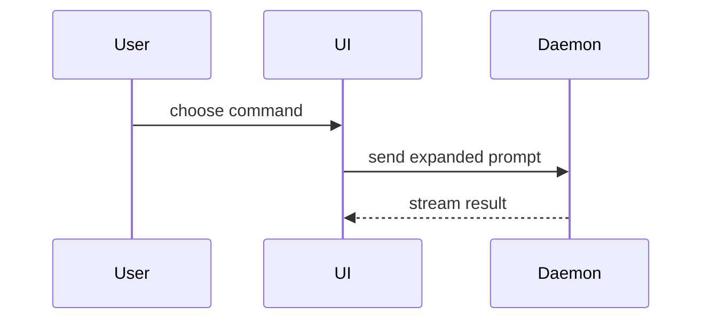

# Show me

One job: the reader gets the point in one pass. Plain words first; a compact visual when it carries the point better than prose; one HTML page only when the content is heavy enough to earn it.

## Conversation (the default: plain words + Markdown)

- Answer in the user's language; keep identifiers, paths, commands, and error text verbatim in their original language.
- Plain words. Decode every term of art the first time it appears — one short line, next to where it lands; prefer the project's own names from docs/GLOSSARY.md when it exists. No unexplained acronym stacks; no internal codenames without a word on what each one is.
- Conclusion first, the reason next, the next step last.
- Markdown only in chat. pi's TUI renders headings, lists, tables, and Mermaid (`markdown.mermaid`, default on) — a well-shaped reply is already a readable reply. Do not write HTML files for normal turns.

## Compact visuals (pick the smallest that makes the point)

- Logic or an algorithm as pseudocode:

```text
on(save)
  if content is unchanged
    return cached result
  write new content
  return fresh result
```

- Runtime flow as a call tree:

```text
submitForm
  createSession
    persistPrompt
    launchAgent
  navigateToSession
```

- UI structure as a component tree, with the files that matter:

```tsx
<SessionPage> (apps/example/src/routes/session.tsx)
  useSessionEvents()
  <SessionToolbar>
    <RunSkillButton> (packages/ui)
```

- File responsibility or a broad refactor as a shallow file tree:

```text
src/
├── commands/       # parses user actions
├── sessions/       # owns session state
└── transport/      # sends API requests
```

- Interaction across process or service boundaries as Mermaid:



- `diff` when the point is what changes and the shape already exists. Match the diff shape to the topic:

```diff
 <SessionPage>
   useSessionEvents()
   <SessionToolbar>
+    <RunSkillButton />
   <SessionTimeline>
+    <SkillResultCard />
```

- Show the whole block when most of it is new, when omission would hide ownership or order, or when the user needs a copyable target shape.

## Key deliverables: one focused HTML page

When the turn's output is a key deliverable or a dense summary — spec handover, the ticket split, a review verdict, retro findings, a comparison, a system-state report — chat Markdown stops being kind to the reader: it reflows, the structure dies in the scroll, and a phone screen buries it. Write ONE focused HTML page and open it.

- One self-contained file: inline CSS, no external fonts, CDNs, or frameworks; real labels and real data from the repo and the conversation, never placeholders.
- Match the product's colors, type, and components when it has them; readable on desktop and mobile.
- Ephemeral page: a temp path such as `/tmp/show-me/<slug>.html`. A page that must survive — evidence, a verdict others reopen — goes where that class of artifact lives instead (`.dev/audit/evidence/`, repo docs).
- Open it with the `bash` tool: `open /tmp/show-me/<slug>.html` (macOS; `xdg-open` on Linux).
- The chat reply carries the conclusion and the path. It does not re-paste the page's content.

## Don't overwhelm

Place each visual next to the short text it supports. Keep only the calls, files, props, states, and boundaries the current question needs. One view or two is usually enough; stacking every view type is the failure mode.
